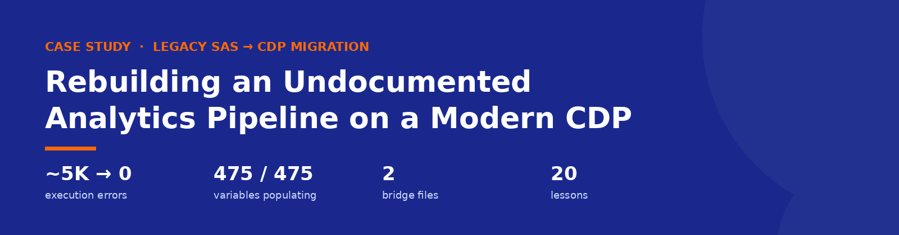
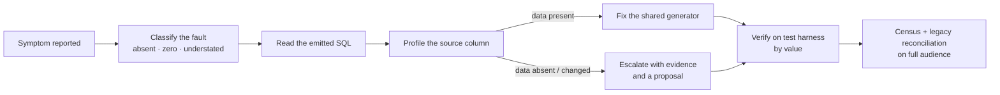
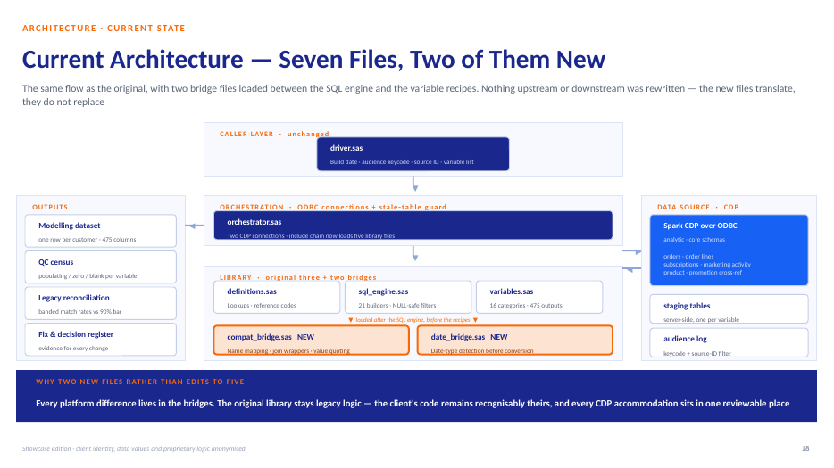
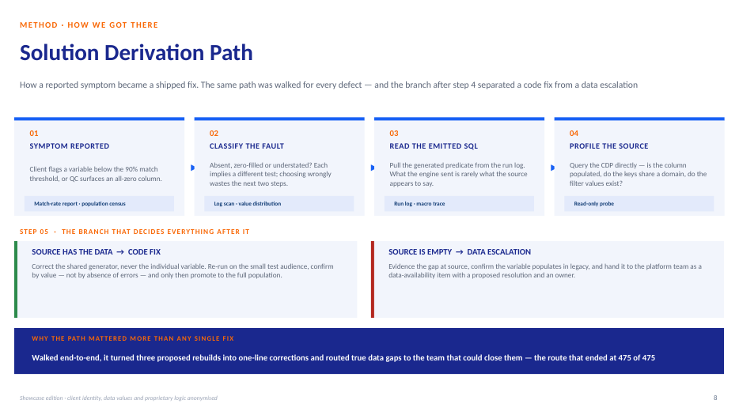
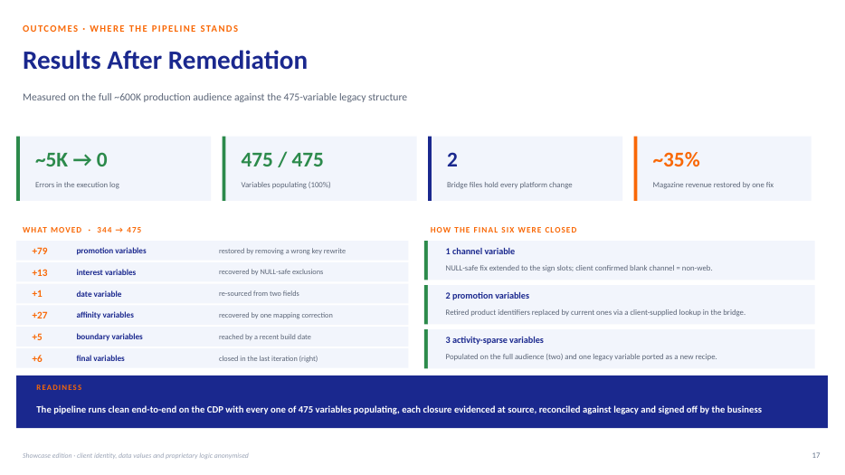

<p align="center">
  
</p>

<p align="center">
  
  
  
  
  
</p>

# Legacy SAS → CDP Migration — Case Study

How a **475-variable marketing-analytics feature engine**, inherited with no documentation, was reverse-engineered, migrated from a legacy Oracle warehouse to a cloud Customer Data Platform, and proven correct to **100% variable population** — without rewriting the client's code.

> **Showcase edition.** "Meridian Media" is a hypothetical organisation. Client identity, data values, file names and proprietary logic are anonymised or generalised. Figures are illustrative; the method and sequence of work are described as executed.

---

## At a glance

| Measure | Start | End |
|---|---|---|
| Execution errors | ~5,000 | **0** |
| Variables populating | 344 / 475 (72%) | **475 / 475 (100%)** |
| Recipe logic rewritten for the platform | — | **None** |
| Files holding platform-specific changes | — | **2 bridge files** |
| Sampled revenue understated by a silent defect | ~35% | **Restored** |
| Production campaigns disrupted | — | **None** |

## Read it here

| Material | View in browser | Editable source |
|---|---|---|
| Showcase deck (47 slides) | [PDF](deck/CDP_Migration_Showcase.pdf) | [PPTX](deck/CDP_Migration_Showcase.pptx) |
| Vol 1 — Engagement, Discovery & Architecture | [PDF](docs/Vol1_Engagement_Discovery_Architecture.pdf) | [DOCX](docs/Vol1_Engagement_Discovery_Architecture.docx) |
| Vol 2 — Diagnosis & Remediation | [PDF](docs/Vol2_Diagnosis_Remediation.pdf) | [DOCX](docs/Vol2_Diagnosis_Remediation.docx) |
| Vol 3 — Assurance, Delivery & Lessons | [PDF](docs/Vol3_Assurance_Delivery_Lessons.pdf) | [DOCX](docs/Vol3_Assurance_Delivery_Lessons.docx) |

---

## The problem

The engagement was scoped as a one-month table-and-field remapping. It became a discovery programme:

- **No documentation.** Five interdependent SAS files; the code was the only specification.
- **SQL written at run time.** 21 shared query builders generate ~2,400 queries per run — one defect in a builder spreads to every variable it serves.
- **Silent platform differences.** NULL handling, date types, renamed columns and drifting reference data produced wrong numbers *without errors*.

## The approach



1. **Discover before migrating** — rebuild the include chain, call graph and variable lineage from the code and its logs, with AI used for comprehension and log forensics.
2. **Translate at the boundary** — two *bridge files* absorb every platform difference; the original recipes stay recognisably the client's.
3. **Diagnose at the source** — prove every defect against the data before changing code.
4. **Assure by census, not by log** — a variable-level population census plus normalised legacy reconciliation defines "done".
5. **Govern meaning** — fixes that change what a number means go to the business owner and into a decision register.

<p align="center">
  
  
</p>

## Path to 100%

| Stage | Change | Populating |
|---|---|---|
| Baseline | First production run on the CDP | 344 |
| 1 | Incorrect key rewrite removed | 423 |
| 2 | NULL-safe exclusion filters | 436 |
| 3 | Email-tenure date re-sourced | 437 |
| 4 | Empty product column remapped | 464 |
| 5 | Recent build date | 469 |
| 6 | Final six closed | **475** |

<p align="center"></p>

## Twenty lessons (selection)

| # | Lesson |
|---|---|
| 01 | Give it evidence, not adjectives |
| 03 | Diagnose at the source, not in the output |
| 04 | Fix the generator, not the symptom |
| 05 | A clean log is not a correct output |
| 09 | Read the log the run actually wrote |
| 12 | Keep the client's code recognisably theirs |
| 16 | The business owns what a number means |
| 19 | Sweep the whole defect class |

All twenty, each with the moment that produced it, are in the deck and in Volume 3.

## Repository structure

```
.
├── README.md
├── deck/
│   ├── CDP_Migration_Showcase.pdf
│   └── CDP_Migration_Showcase.pptx
├── docs/
│   ├── Vol1_Engagement_Discovery_Architecture.(pdf|docx)
│   ├── Vol2_Diagnosis_Remediation.(pdf|docx)
│   └── Vol3_Assurance_Delivery_Lessons.(pdf|docx)
└── assets/
    ├── banner.png
    ├── deck-cover.png
    ├── architecture.png
    ├── derivation-path.png
    └── results.png
```

## Skills demonstrated

`SAS macro engineering` · `SQL / Spark SQL` · `Legacy reverse-engineering` · `Data migration` · `Data quality & reconciliation` · `Root-cause analysis` · `AI-assisted engineering` · `Production change control` · `Stakeholder governance`

---

<sub>Content © the authors. Shared as a portfolio case study; the client and all identifying details are fictionalised.</sub>
